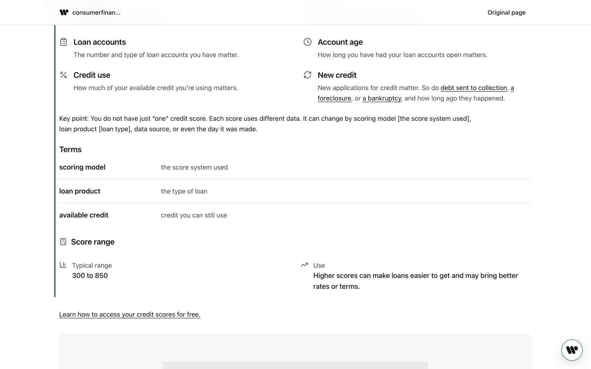
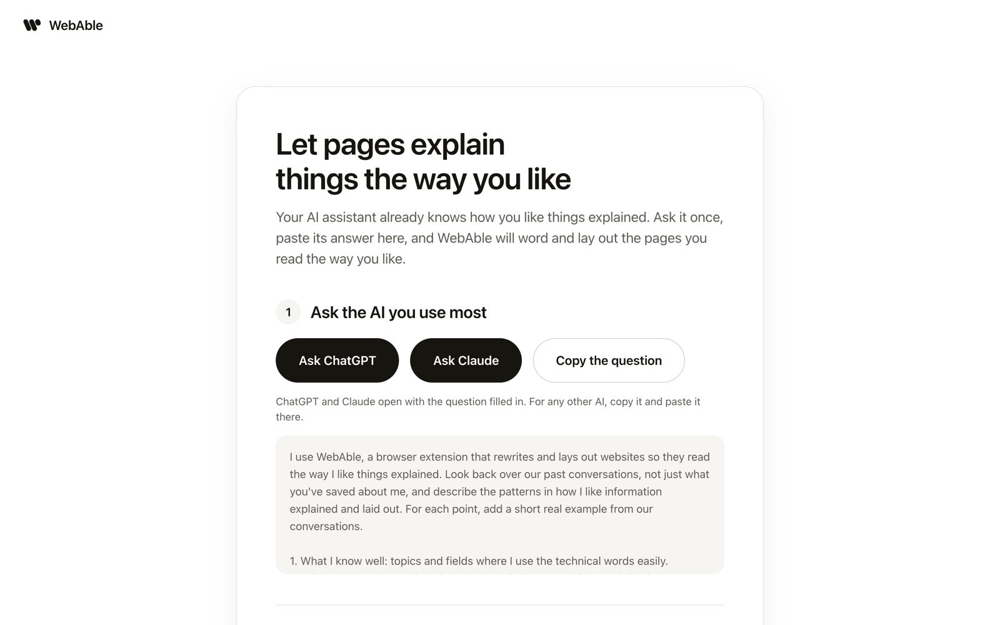
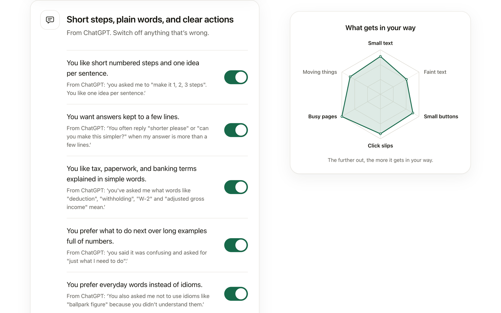
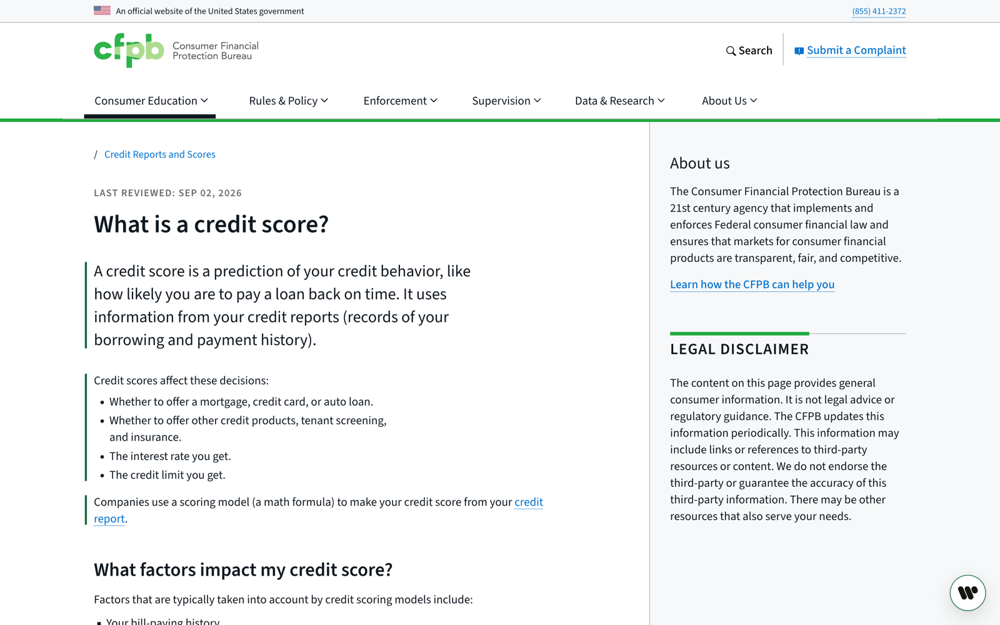
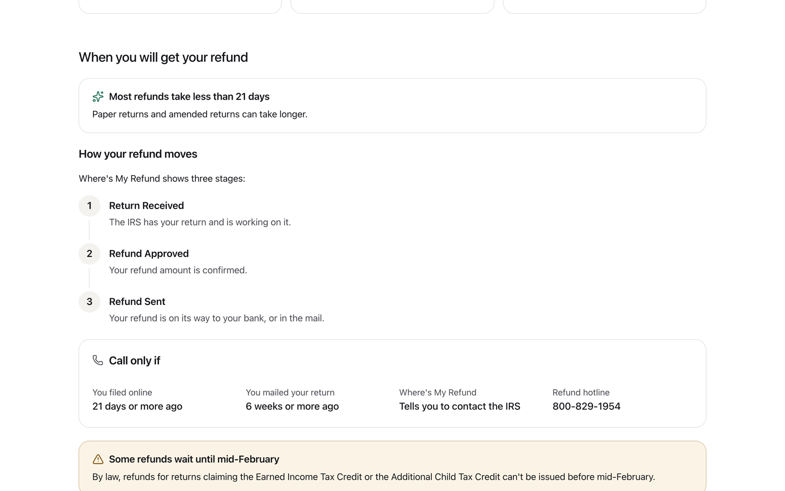
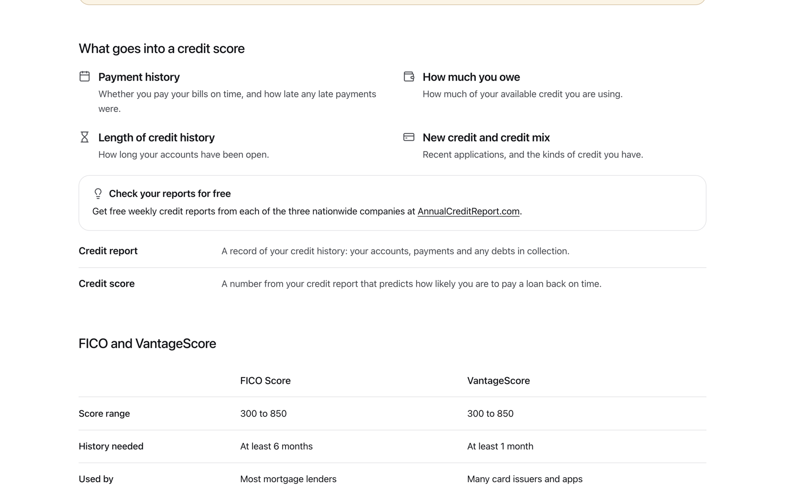
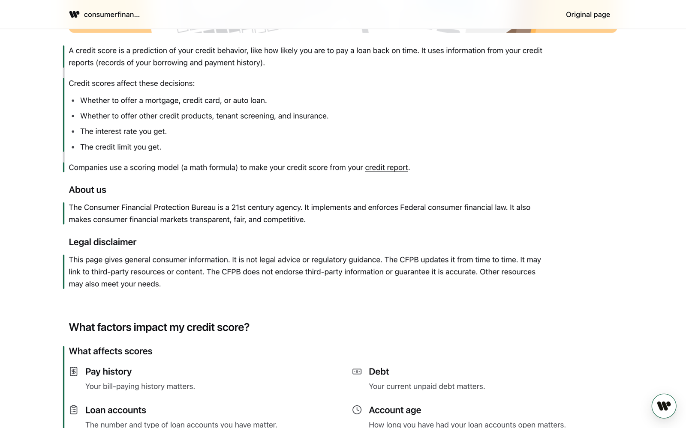
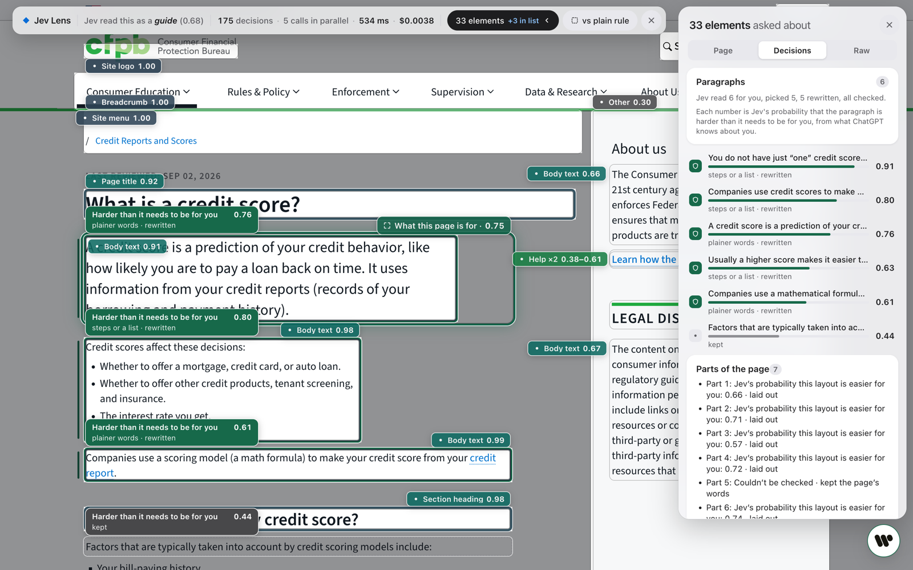
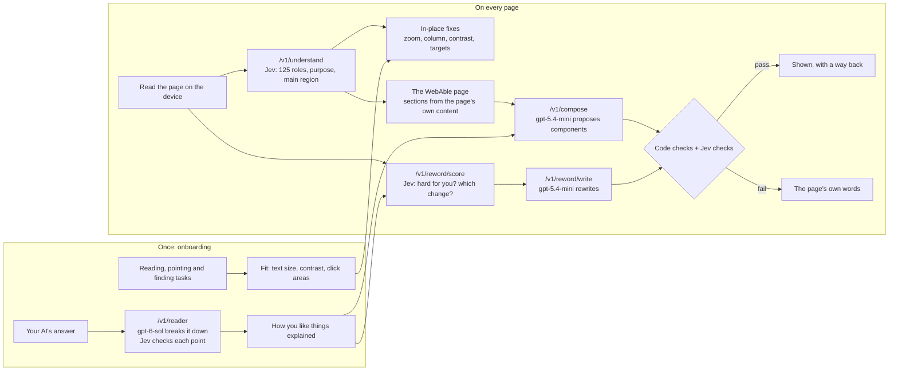

<p align="center">
  <picture>
    <source media="(prefers-color-scheme: dark)" srcset="docs/images/logo-white.svg" />
    
  </picture>
</p>

<h1 align="center">WebAble</h1>

<p align="center">
  <strong>Fits every website to the person using it, without asking what's wrong with you.</strong>
</p>

<p align="center">
  A Chrome extension built at <strong>Gator Hack V</strong> (UF AI Days, October 2026) ·
  powered by <strong>Jev</strong>, TypeSafe AI's calibrated decision model, and GPT
</p>

<p align="center">
  <a href="#getting-started">Getting started</a> ·
  <a href="#how-it-works">How it works</a> ·
  <a href="#what-weve-measured">What we've measured</a> ·
  <a href="#project-layout">Project layout</a>
</p>

<p align="center">
  
</p>

<p align="center"><sub>A real page from consumerfinance.gov, laid out by WebAble for someone who is new to money terms and likes short steps.</sub></p>

---

## Contents

- [Why WebAble](#why-webable)
- [What it does](#what-it-does)
  - [1. Learns how you read](#1-learns-how-you-read)
  - [2. Rewrites hard paragraphs for you](#2-rewrites-hard-paragraphs-for-you)
  - [3. Lays out every reading page the way you like](#3-lays-out-every-reading-page-the-way-you-like)
  - [4. Shows its work](#4-shows-its-work)
- [How it works](#how-it-works)
- [Why Jev](#why-jev)
- [Every change is checked](#every-change-is-checked)
- [What we've measured](#what-weve-measured)
- [Getting started](#getting-started)
- [Try it](#try-it)
- [Project layout](#project-layout)
- [Tests](#tests)
- [Privacy](#privacy)
- [Limits](#limits)
- [Team](#team)

---

## Why WebAble

Accessibility standards are fixed. People aren't. They vary in range, in combination and in circumstance: one person needs larger text, another misses small buttons, another loses the thread in a long paragraph full of tax words. Most of the web doesn't meet basic accessibility standards, and even sites that do are built for an average reader who doesn't exist.

WebAble learns what gets in *your* way and changes every page to fit you. It learns the need, never the cause: it never asks for or names a condition.

## What it does

### 1. Learns how you read

A short onboarding measures what you'd never think to set yourself: a comfortable text size, whether faint words are hard to see, how precisely you click, and how much busy pages slow you down, on three real websites.

The last step, **Your context**, asks the AI assistant you use most one question: *how do I like things explained?* ChatGPT and Claude open with the question already filled in. You paste the answer back, and WebAble breaks it into plain points, each with the AI's own words as evidence. Jev drops any point the answer doesn't support. You can switch off anything that's wrong.

<table>
  <tr>
    <td width="50%"></td>
    <td width="50%"></td>
  </tr>
  <tr>
    <td align="center"><sub>Ask the AI you already use</sub></td>
    <td align="center"><sub>What WebAble took from the answer, with evidence</sub></td>
  </tr>
</table>

### 2. Rewrites hard paragraphs for you

On every reading page, Jev reads each paragraph and gives a probability that it's harder than it needs to be *for this person*. It also picks one change: plainer words, steps or a list, shorter, or main point first. The rewrite replaces the paragraph in place, in the site's own font, with a thin green line beside it. Click the line to see the original.

Two people get different pages. In our tests, a newcomer to US taxes got 6 of 8 IRS refund paragraphs rewritten; a finance analyst got none.

<p align="center">
  
</p>

### 3. Lays out every reading page the way you like

Modelled on the component interfaces of current AI assistants, WebAble opens a clean version of every reading page and builds it in, section by section. Each section becomes the components that fit what it says, and what you like:

| Component | When it's used |
|---|---|
| **Key facts** | The page states label-and-value facts (hours, phone, deadlines) |
| **Steps** | The page gives actions in order |
| **Number tiles** | The page states a figure with its qualifier |
| **Comparison table** | The page compares two or more things on the same points |
| **Callout** | The page states a warning, restriction, deadline or tip |
| **Definitions** | The page uses terms that are new to you |
| **Quote** | An exact quotation, with who said it |
| **Contact** | Phone numbers, emails, addresses and hours |
| **Icon grid** | Parallel points (reasons, features, options) |
| **Prose** | Everything else. Plain paragraphs are always a valid choice |

The page's own links still work, its bold words stay bold, and any section can be switched back to the page's own words.

<table>
  <tr>
    <td width="50%"></td>
    <td width="50%"></td>
  </tr>
  <tr>
    <td colspan="2" align="center"><sub>The component library (development preview with sample content)</sub></td>
  </tr>
</table>

<p align="center">
  
</p>

### 4. Shows its work

The **Jev view** shows every decision on the page: each element's role and Jev's probability, the page's purpose, how long the read took and what it cost. For paragraphs and sections it shows Jev's probability that each is harder than it needs to be for you, and whether the new layout is easier.

<p align="center">
  
</p>

WebAble also fits text size, contrast, click areas and motion in place on every site. Every change is checked, and anything that breaks the page is undone.

## How it works



1. **Read on the device.** The extension reads the page's structure: headings, paragraphs, lists, tables, controls and where things sit.
2. **Jev understands the page.** Each element's evidence goes inside its own question, about 100 to 180 in one call. Jev returns probabilities: one of 125 roles for each element, how important it is, what the page is for, and where the main content is. Code turns probabilities into actions only above set thresholds.
3. **Fit in place.** Text grows by page zoom, keeping the site's own heading sizes. Content sits in a centred column. Faint text gets darker and small buttons get bigger click areas. Each change is checked and undone if it breaks something.
4. **The WebAble page.** On reading pages, WebAble opens its own clean page built from the site's content. Each section is sent to `/v1/compose`; gpt-5.4-mini proposes components from a fixed catalogue, as data only, never code. Jev gives the probability that the layout is easier for this person than the page's own text.
5. **Paragraphs for you.** Jev scores every paragraph against how you like things explained. gpt-5.4-mini rewrites the ones it picked.
6. **Check everything.** Code and Jev check each rewrite and layout (see [below](#every-change-is-checked)). Anything that fails shows the page's own words.

<details>
<summary><strong>The model never writes code</strong></summary>

<br />

Models in WebAble return data that WebAble validates, never markup or scripts. Jev returns probabilities over options we wrote; GPT returns JSON in a strict schema that names components from a fixed catalogue. The extension draws everything from its own Preact components inside a closed shadow root. This also keeps us inside the Chrome Web Store's rule against remote code.

</details>

## Why Jev

The Gator Hack V challenge was **"Fresh off the frontier"**: build on a technology made public in the last 12 months. Ours is **Jev**, TypeSafe AI's "System One" decision model, public since 15 September 2026, with image input added in v1.14 on 14 October 2026.

Jev makes fast, calibrated decisions over options you define. It's the right tool for decisions WebAble makes many times a second, on every page:

- reading a page: about 175 decisions in about half a second, for a third of a cent;
- deciding per paragraph whether it's hard *for this person*, and which change helps;
- checking that a rewrite or a layout dropped nothing and added nothing;
- checking that each point taken from your AI's answer is actually supported by it;
- gating every change on its probability, so WebAble only acts where Jev is sure.

GPT writes the words; Jev decides and checks; code does the maths and has the last word.

## Every change is checked

| Check | What it catches |
|---|---|
| Numbers kept | A number, amount, date or phone number dropped or changed |
| No new numbers | A figure that isn't on the page |
| Limiting words kept | A lost *not*, *only*, *unless*, *except* or *at least* |
| Links kept | Each of the page's links appears exactly once |
| Quotes exact | Any change inside quotation marks |
| Coverage | A section's content missing from its layout |
| Jev: dropped? | A fact, condition or warning left out |
| Jev: added? | A claim, reason or piece of advice the page doesn't make |
| Jev: easier? | A layout that isn't easier for this person than the page's own text |
| Page checks | Overlapping text, clipping, sideways scrolling, unreachable controls |

A failed check never reaches the screen. In our test runs the checks caught a changed phone number, an invented "2000s", a dropped "Have your tax return on hand", and a made-up "Do not check too early" warning.

## What we've measured

| | Result | Source |
|---|---|---|
| **Fits real sites** | Made text larger with nothing left broken on **32 of 50** popular sites (news, health, government, shops, banks) | 50-site run in branded Chrome, [docs/CLAIMS.md](docs/CLAIMS.md) |
| **Checks its own work** | Undid **22** of its own changes on 15 sites after a check failed | Same run |
| **Fast and cheap** | A Jev page read: median **430 ms**, **$0.0034** | Same run, 46 pages |
| **Jev vs GPT-6 Sol** | Same questions, same 10 pages: about **40× faster** and **18× cheaper**, picking the same main action on 9 of 10 | [docs/CLAIMS.md](docs/CLAIMS.md) |
| **Element roles** | **125** kinds of page element; accuracy held at **86–92%** on pages it was never tuned on | Held-out BBC, ESPN, Coursera and Newegg pages |
| **Personal rewrites** | Newcomer: 6 of 8 IRS paragraphs rewritten. Finance analyst: 0 of 8 | Probe with two sample AI answers |
| **Paragraph scoring** | 126–368 ms for a whole page | Same probe |

The rewrite and layout numbers come from our own test runs with sample AI answers, not from studies with people. We haven't run a study with people yet.

## Getting started

**You'll need:** Node 24, pnpm 10, Google Chrome, a TypeSafe API key for Jev, and an OpenAI API key.

```bash
git clone https://github.com/cadenshokat/gatorhack.git webable
cd webable
pnpm install
```

Create `.env` in the repo root:

```bash
TYPESAFE_API_KEY=your-typesafe-key
OPENAI_API_KEY=your-openai-key
OPENAI_BUDGET_USD=15
```

Start the server (it holds the keys and talks to Jev and OpenAI on `127.0.0.1:41741`):

```bash
pnpm dev:server
```

Build the extension:

```bash
pnpm --filter @webable/extension build
```

Load it in Chrome:

1. Open `chrome://extensions` and turn on **Developer mode**.
2. Click **Load unpacked** and pick `apps/extension/.output/chrome-mv3`.
3. The onboarding opens in a new tab. Take it, or skip it and use the defaults.

## Try it

| Page | What to look for |
|---|---|
| [What is a credit score?](https://www.consumerfinance.gov/ask-cfpb/what-is-a-credit-score-en-315/) (CFPB) | The WebAble page: an icon grid, definitions and number tiles |
| [Refunds](https://www.irs.gov/refunds) (IRS) | Paragraphs rewritten for a newcomer, none for an expert |
| [Florida vs Kentucky history](https://floridagators.com/sports/football/opponent-history/university-of-kentucky/32) | Scoreboard and stats laid out from the page |
| [Best chocolate chip cookies](https://www.allrecipes.com/recipe/10813/best-chocolate-chip-cookies/) | Just the ingredients and the steps |
| `http://127.0.0.1:41741/demo/alderra/refill.html` | A fictional pharmacy refill, one step at a time |

Open the WebAble button on any page for text size, "What WebAble did here" with undo, and the Jev view.

## Project layout

```
.
├── apps/
│   ├── extension/            Chrome MV3 extension (WXT + Preact)
│   │   ├── entrypoints/      background, content script, onboarding, popup
│   │   └── src/
│   │       ├── engine/       reads the page, plans and checks every change, rewrites, layouts
│   │       └── ui/           the WebAble page and its components, the Jev view, the in-page sheet
│   └── server/               Hono server on 127.0.0.1:41741: Jev and OpenAI calls, demo pages
├── packages/
│   └── core/                 shared contracts and logic: Jev questions, checks, fit maths, layouts
├── scripts/
│   ├── eval/                 real-Chrome evaluation harness
│   ├── claims/               the pipelines behind docs/CLAIMS.md
│   ├── reword/               live probe for paragraph rewrites
│   └── compose/              live probe for page layouts
└── docs/                     claims, design specs, research and demo notes
```

**Stack:** TypeScript 5.9, pnpm workspaces, WXT 0.21 + Preact 10, Hono, Vitest, zod, Lucide icons. **Models:** Jev 1.14 (TypeSafe AI), gpt-6-sol and gpt-5.4-mini (OpenAI).

## Tests

```bash
pnpm -r typecheck
pnpm -r test
```

787 unit and DOM tests across core, server and extension. The real-Chrome evaluation harness runs the built extension on live sites at Retina scale:

```bash
pnpm eval --browser chrome --dpr 2 --size 1440x900 --only alderra-refill
```

## Privacy

- **What it learns about you stays on your laptop.** Your fit, your browsing beliefs and the points taken from your AI's answer live in Chrome's local storage. The raw AI answer is not kept after it's broken down.
- **To read a page,** Jev gets the page's structure: roles, sizes and positions, with interface labels only.
- **To rewrite or lay out a page,** the page's paragraph text and the points you left switched on are sent to the WebAble server and the models.
- **WebAble never rewrites** pages with password or payment fields, or mail, chat and banking sites.
- **Never shown, never inferred:** WebAble never names or guesses a condition. It talks about what gets in your way, not about you.

## Limits

- WebAble needs its local server running; there's no hosted version yet.
- Rewrites and layouts take 2–4 seconds per section. The page shows its own words first and settles in once, then stays still while you read.
- Some sites block the automated checks, and a few large stores still scroll sideways after fitting.
- Paragraph rewrites run on English pages only.
- No study with people yet: the claims above are from automated runs and simulations.

## Team

Built at [Gator Hack V](https://ufgatorhack.com) by:

- **Caden Shokat**: product and engineering
- **Sid Pandey**: story, research and pitch

<sub>WebAble uses Jev by TypeSafe AI and OpenAI models. Icons from <a href="https://lucide.dev">Lucide</a> (ISC). Screenshots show public U.S. government pages (consumerfinance.gov, irs.gov).</sub>
